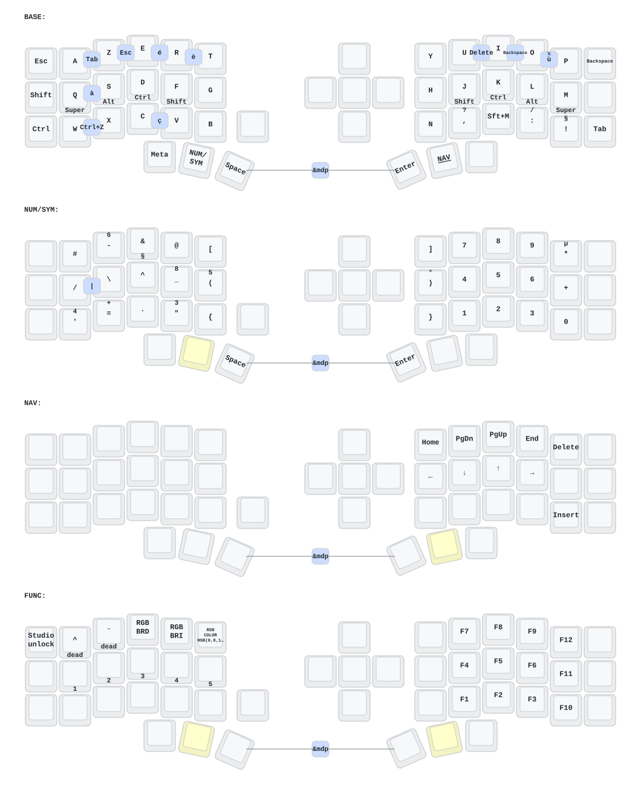

# Corne-J — French AZERTY layout

The host must use **French AZERTY** (on the ThinkPad: XKB `fr(azerty)`).
Character bindings in `config/eyelash_corne.keymap` use `FR_*` names;
`config/keys_fr.h` translates them to ZMK's US HID keycodes.
This header is local and requires no extra West module or package.
Keymap Drawer is run with `uvx --from keymap-drawer keymap` (cached tool,
no system package installation).

Examples: `&kp FR_A` types `a`, `&kp FR_U_GRAVE` types `ù`,
`&kp FR_N1` types `1`, and `&kp FR_LEFT_BRACE` types `{`.
`FR_N0` through `FR_N9` include Shift; `FR_CARET` produces a direct `^`
on Linux `fr(azerty)`, while `FR_DEAD_CIRCUMFLEX` is the dead key for accents.
The header also provides aliases for `é`, `è`, `à`, `ç`, and other symbols
for future changes; they are not added to the current layout.

## Current layers

### Home row mods (BASE)

A tap types the French letter; holding activates the modifier:

| Letter | Q | S | D | F | J | K | L | M |
| --- | --- | --- | --- | --- | --- | --- | --- | --- |
| Hold | Super | Alt | Ctrl | Shift | Shift | Ctrl | Alt | Super |

Both Alt bindings send Left Alt (Right Alt is AltGr on French AZERTY).
The dedicated modifier keys remain available.
The left/right behaviors use `balanced`, a 280 ms tapping term,
150 ms prior idle and 175 ms quick tap. Opposite-hand keys and all thumbs
can trigger a hold; same-hand rolls resolve to letters before the timeout.
`hold-trigger-on-release` allows holding several modifiers together.
Tap then hold the same letter quickly to repeat it.
These values follow the [ZMK home row mods example](https://zmk.dev/docs/keymaps/behaviors/hold-tap#custom-hold-tap-examples)
and should be tuned after testing the flashed firmware.

### Combos (BASE)

| Keys pressed together | Action |
| --- | --- |
| Z + E | Escape |
| I + O | Backspace |
| U + I | Delete |
| A + Z | Tab |
| W + X | Ctrl+Z (undo) |
| E + R | é |
| R + T | è |
| Q + S | à |
| C + V | ç |
| O + P | ù |

These combos only apply on BASE. Press both keys within 40 ms,
after at least 150 ms without a non-modifier key press.
Undo uses `LC(FR_Z)` so the shortcut matches French AZERTY.

### French accents

Use the BASE combos above for lowercase é, è, à, ç and ù.
Q + S still produces `|` on NUM/SYM.
Hold both layer thumbs (NUM/SYM + NAV) to activate FUNC:
the physical A key sends dead circumflex and Z sends dead diaeresis,
replacing RGB toggle and effect selection at these positions.
Release the accent key and both layer thumbs, then type the vowel:
`^` then E gives ê, and `¨` then I gives ï.
The host must use a French AZERTY layout with dead keys enabled.
The direct `^` on NUM/SYM remains available for code.

The five optional central switch positions remain disabled.

```text
BASE
Esc    A Z E R T           Y U I O P Backspace
Shift  Q S D F G           H J K L M ù
Ctrl   W X C V B  Space    N , ; : ! Tab
          Meta NAV Space  Enter NUM/SYM AltGr

NUM/SYM (right thumb, hold)
       # { [ ( )           7 8 9
       | \ ^ @ =           4 5 6
       ] } . / §           1 2 3 0

NAV (left thumb, hold)
Studio unlock             Home PgDn PgUp End Delete
                          Left Down Up Right Delete
                          Home PgDn PgUp End Insert
```

Navigation and modifiers keep their ordinary ZMK names. Only printable
characters use `FR_*`. The alias conversion preserves the V1 keycodes,
including the `§` binding; it does not change the physical layout.

## Studio and diagrams

ZMK Studio's host locale selection is still planned. These aliases improve
the source file but do not change Studio's US key labels. Studio edits are
stored on the keyboard and do not update this repository. After editing and
flashing this source, a Studio-managed keyboard needs **Restore Stock
Settings** to use the compiled layout; this replaces saved Studio edits.

`keymap_drawer.config.yaml` includes French legends for the aliases in use.
The checked-in YAML and SVG below were regenerated locally with Keymap
Drawer 0.23.0 and checked visually. The Draw Keymap workflow updates them
after publication.

## Local workflow and rollback

The build calls `.github/workflows/build-user-config.yml`, a local copy of
the official ZMK v0.3.0 workflow with Node 24 actions: checkout v5, cache v5,
and upload-artifact/merge v6. This removes Node 20 deprecation warnings
while keeping the v0.3.0 build logic and the firmware revision in `config/west.yml`.
When updating the build workflow, compare it with the upstream v0.3.0 source
linked in its header. Validation of workflow changes requires a GitHub Actions run.

Working copy: `~/Code/corne-j-keyboard-zmk`, branch `keymap-v1`.
This path is outside the ThinkPad's Syncthing folders (`~/Documents` and
`~/Shared`); Git handles the firmware repository.

Review with `git diff` and `git diff --check`. Commit and push only when
ready, then check the firmware build and test the resulting UF2 on hardware.
The local alias conversion was checked by preprocessing both versions with
ZMK v0.3.0 headers: all three layers have exactly the same expanded bindings.
This is a static check, not a firmware build or hardware test.

To undo this conversion **before any subsequent edits**, restore the five
tracked files with `git restore -- config/eyelash_corne.keymap
keymap_drawer.config.yaml README.md keymap-drawer/eyelash_corne.yaml
keymap-drawer/eyelash_corne.svg` (as one command), then move the untracked
`config/keys_fr.h` outside the repository. Preserve any later work first.
Because the HID bindings are unchanged, this conversion alone does not
require flashing the keyboard.

References: [ZMK Studio](https://zmk.dev/docs/features/studio),
[ZMK Locales](https://github.com/joelspadin/zmk-locales).


